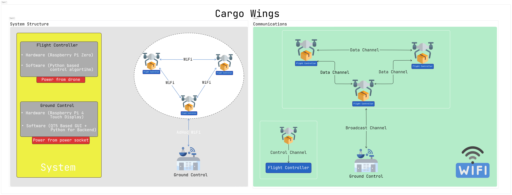
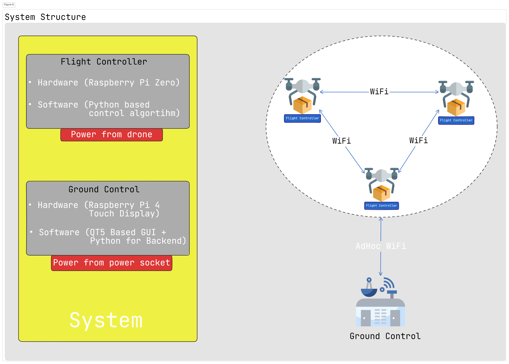
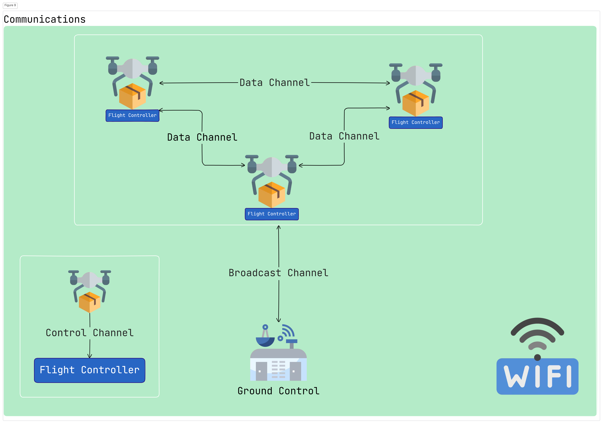

# Cargo Wings

## What we have done so far?

### Hardware

- *Raspberry Pi Zero(Flight Controller)*
- *Raspberry Pi 4(Ground Control)*

We chose Raspberry Pi boards because they are compact, have WiFi connectivity, support Linux OS, and are easy to develop with.

### Mechanics

- Printed 3D Parts

### Firmware

- *Ground Control* 

- *Raspberry Pi Zero Controller* 

### Software

We used mainly python as a programming language in our software and firmware environment, so python's flexible usage area is a key factor for our development process.

**Simulation**

This simulation is based on pygame (which is a game library for python), we used pygame's game methods for leveraging in simulation environment.

### Communications

- 

### Future Work

- UWB Based Positioning PCB
