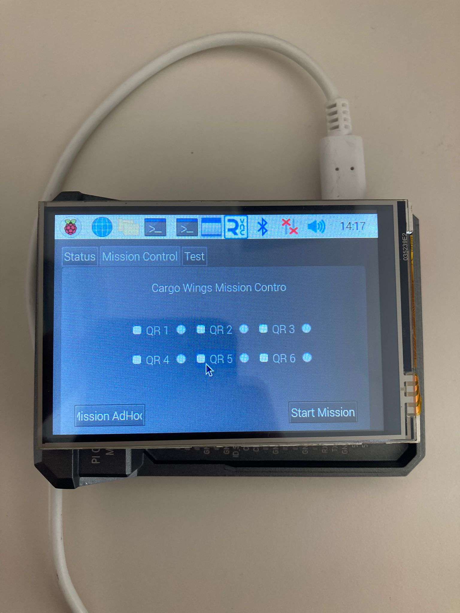
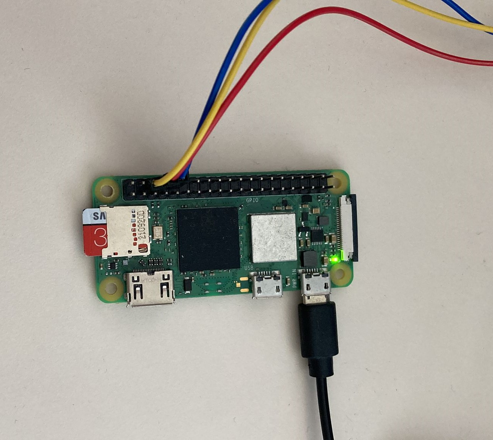

# Table of Contents

1. [System Flow](#system-flow)
    - [Networking](#networking)
2. [Ground Control](#ground-control)
    - [Ground Control Responsibilites](#ground-control-responsibilites)
3. [Drone Control (Raspberry Pi Zero)](#drone-control-raspberry-pi-zero)
    - [Drone Control Responsibilites](#drone-control-responsibilites)

# System Flow

- Ground control sends the mission map to all the Raspberry Pi Zero devices that are registered.
- The Raspberry Pi Zero devices receive the mission map and calculate the cost matrix.
- Once the calculation is done, each drone takes off to the mission with the lowest cost.
- After the drones arrive at their duty locations, switch to adhoc network mode and notify ground control, ground control is connected to their network, accessing the camera image and QR code control is provided.

## Networking

- WiFi ad-hoc mode is employed for transmitting the drone mission map and for inter-drone communication.
- Raspberry Pi Zeros connect to the Tello drone's access point to communicate with it. However, during this connection, ad-hoc mode is disabled.

## Ground Control (Raspberry Pi 4 + Display)

<p align="center">
  
</p>

<hr>
<br>
<br>

### Ground Control Responsibilites

- Creating the interface to determine the task distribution map.
- Sending the designated map to the drones.
- Scanning QR codes by accessing camera images from drones as they arrive at their duty stations.

#### Important Pseudo Methods

```python
def create_task_distribution_map_interface():
    pass

def send_map_to_drones(designated_map):
    pass

def scan_qr_codes():
    pass

```

#### Code

```python
import sys
from PyQt5.QtWidgets import QApplication, QMainWindow
from PyQt5.QtCore import Qt
from cargo_wings_ui import Ui_MainWindow
import subprocess
import json
import time
import socket
from djitellopy import Tello
import cv2
from pyzbar.pyzbar import decode

def run_shell_script(script_name):
    try:
        subprocess.run(['./{}'.format(script_name)], shell=True, check=True)
        print("Successfully ran {}".format(script_name))
    except subprocess.CalledProcessError as e:
        print("Error running {}: {}".format(script_name, e))

def send_json_packet(ip_address, json_data):
    # Convert dictionary to JSON string
    json_string = json.dumps(json_data)
    # Send JSON packet to specified IP address using UDP
    udp_ip = ip_address
    udp_port = 5005  # Choose a suitable port
    try:
        sock = socket.socket(socket.AF_INET, socket.SOCK_DGRAM)
        sock.sendto(json_string.encode(), (udp_ip, udp_port))
        print("Sent JSON packet to {}: {}".format(ip_address, json_string))
    except Exception as e:
        print("Error sending JSON packet: {}".format(e))
    finally:
        sock.close()

class MainWindow(QMainWindow):
    def __init__(self):
        super().__init__()
        self.ui = Ui_MainWindow()
        self.ui.setupUi(self)
        self.setWindowFlags(Qt.FramelessWindowHint)

        self.mission_matrix = []

        self.ui.btn_take_picture.clicked.connect(self.take_picture_and_scan_qr_code)

        self.ui.btn_connect_tello_ap.clicked.connect(self.connect_tello_ap)

        self.ui.btn_connect_homenetwork.clicked.connect(self.connect_homenetwork)

        self.ui.btn_start_adhoc.clicked.connect(self.start_adhoc)

        self.ui.btn_adhoc_mission.clicked.connect(self.adhoc_mission)

    def adhoc_mission(self):

        self.mission_matrix = [[int(self.ui.btn_qr1.isChecked()),
                               int(self.ui.btn_qr2.isChecked()),
                               int(self.ui.btn_qr3.isChecked())],
                               [int(self.ui.btn_qr4.isChecked()),
                                int(self.ui.btn_qr5.isChecked()),
                                int(self.ui.btn_qr6.isChecked())]]

        ip_address = "192.168.1.3"
        send_json_packet(ip_address, {"mission_matrix": self.mission_matrix})


    def send_json_packet(ip_address, json_data):
        # Convert dictionary to JSON string
        json_string = json.dumps(json_data)
        # Send JSON packet to specified IP address using UDP
        udp_ip = ip_address
        udp_port = 5005  # Choose a suitable port
        try:
            sock = socket.socket(socket.AF_INET, socket.SOCK_DGRAM)
            sock.sendto(json_string.encode(), (udp_ip, udp_port))
            print("Sent JSON packet to {}: {}".format(ip_address, json_string))
        except Exception as e:
            print("Error sending JSON packet: {}".format(e))
        finally:
            sock.close()

    def start_adhoc(self):

        run_shell_script("start_adhoc.sh")

        pass


    def take_picture(self):

        pass

    def take_picture_and_scan_qr_code(self):

        # Print message when the button is clicked
        tello = Tello()
        tello.connect()
        tello.streamon()

        # Adjust this value as needed
        num_frames = 1  # Number of frames to capture

        # Open the video stream
        vidcap = cv2.VideoCapture(tello.get_udp_video_address())

        # Loop through frames
        for count in range(num_frames):
            success, frame = vidcap.read()
            if success:

                # Decode QR codes
                decoded_objects = decode(frame)

                if decoded_objects:
                    # QR codes found, print their data
                    for obj in decoded_objects:
                        print("Data:", obj.data.decode('utf-8'))
                        print("Type:", obj.type)
                        print()
                else:
                    print("No QR codes found in the frame.")

                cv2.imwrite("frame_%d.jpg" % count, frame)

            else:
                print('Failed to capture frame %d' % count)

        # Release resources
        tello.streamoff()
        vidcap.release()

    def connect_tello_ap(self):

        run_shell_script("connect_tello.sh")

    def connect_homenetwork(self):

        run_shell_script("connect_homenetwork.sh")

if __name__ == "__main__":
    app = QApplication(sys.argv)
    window = MainWindow()
    window.show()
    sys.exit(app.exec_())

```

## Drone Control (Raspberry Pi Zero)


<p align="center">

</p>


### Drone Control Responsibilites

- Generate a cost matrix using the mission map provided by ground control and the drone's current location.

- Once the closest mission locations are identified, disable communication with ground control (exit adhoc mode), establish a connection with the Tello Drone Access Point (AP), and initiate drone control operations.

- Upon reaching the duty station, switch back to adhoc mode, and ensure that ground control is notified of the successful arrival at the designated location.

<br>
<br>
<br>
<br>

#### Important Pseudo Methods


```python
def create_cost_matrix(mission_map):
    pass

def determine_closest_mission_locations(cost_matrix):
    pass

def exit_adhoc_mode():
    pass

def connect_to_tello_drone_ap():
    pass

def arrive_at_duty_station():
    pass

def switch_to_adhoc_mode():
    pass

def notify_ground_control_of_arrival():
    pass
```

#### Code

```python
import subprocess
import json
import time
import socket
import datetime
from lightdjitellopy import Tello

global mission_matrix

def run_shell_script(script_name):
    try:
        subprocess.run(['./{}'.format(script_name)], shell=True, check=True)
        print("Successfully ran {}".format(script_name))
    except subprocess.CalledProcessError as e:
        print("Error running {}: {}".format(script_name, e))


def send_json_packet(ip_address, json_data):
    # Convert dictionary to JSON string
    json_string = json.dumps(json_data)
    # Send JSON packet to specified IP address using UDP
    udp_ip = ip_address
    udp_port = 5005  # Choose a suitable port
    try:
        sock = socket.socket(socket.AF_INET, socket.SOCK_DGRAM)
        sock.sendto(json_string.encode(), (udp_ip, udp_port))
        print("Sent JSON packet to {}: {}".format(ip_address, json_string))
    except Exception as e:
        print("Error sending JSON packet: {}".format(e))
    finally:
        sock.close()


def move_tello(tello, direction, distance):
    if distance == 0:
        return  # Skip movement commands if distance is zero

    # Check if the drone has landed, then takeoff again
    if tello.is_flying is False:
        tello.takeoff()

    if direction == 'up':
        tello.move_up(distance)
    elif direction == 'down':
        tello.move_down(distance)
    elif direction == 'left':
        tello.move_left(distance)
    elif direction == 'right':
        tello.move_right(distance)
    elif direction == 'forward':
        tello.move_forward(distance)
    elif direction == 'backward':
        tello.move_back(distance)
    elif direction == 'rotate_clockwise':
        tello.rotate_clockwise(distance)
    elif direction == 'rotate_counter_clockwise':
        tello.rotate_counter_clockwise(distance)

def wait_message():
    UDP_IP = '192.168.1.3'
    UDP_PORT = 5005
    sock = socket.socket(socket.AF_INET, socket.SOCK_DGRAM)
    sock.bind((UDP_IP, UDP_PORT))

    while True:
        msg, addr = sock.recvfrom(1024)
        now = datetime.datetime.now()
        print('Time:', now, 'RECV', msg.decode())
        rcvd_msg = f'Time: {now} RECV {msg.decode()}'

        # Parse incoming message and update mission matrix
        parse_incoming_message(msg.decode())

        # You can perform actions based on the received message here
        if mission_matrix:
            break

def parse_incoming_message(json_data):

    global mission_matrix

    try:
        data = json.loads(json_data)
        mission_matrix = data.get("mission_matrix")

        if mission_matrix:

            # Update self.mission_matrix with the incoming matrix
            mission_matrix = mission_matrix

            print("Updated mission matrix:", mission_matrix)

        else:
            print("No mission matrix found in the incoming message.")
    except json.JSONDecodeError as e:
        print("Error parsing incoming JSON message:", e)


def main():
    # Run start_adhoc.sh
    run_shell_script("start_adhoc.sh")

    # Wait for message
    print("Waiting for a message...")
    wait_message()

    print(mission_matrix)

    # Run connect_tello.sh
    run_shell_script("connect_tello.sh")

    # Initialize Tello
    tello = Tello()
    tello.connect()
    tello.takeoff()

    # Define starting position
    start_x = 0
    start_y = 0
    # Define movement distance
    distance = 20  # 10 cm between each row and column index
    # Save starting position
    current_x = start_x
    current_y = start_y
    # Loop through the mission_matrix
    for i in range(len(mission_matrix)):
        for j in range(len(mission_matrix[0])):
            if mission_matrix[i][j] == 1:
                # Calculate target position
                target_x = start_x + j * distance
                target_y = start_y + i * distance

                # Calculate movement offsets
                dx = target_x - current_x
                dy = target_y - current_y

                # Determine the direction to move horizontally
                if dx > 0:
                    horizontal_direction = 'right'
                else:
                    horizontal_direction = 'left'
                # Determine the direction to move vertically
                if dy > 0:
                    vertical_direction = 'forward'
                else:
                    vertical_direction = 'backward'

                # Move Tello to target position
                move_tello(tello, horizontal_direction, abs(dx))  # Move horizontally
                move_tello(tello, vertical_direction, abs(dy))  # Move vertically

                # Update current position
                current_x = target_x
                current_y = target_y
                # Land Tello
                tello.land()
                time.sleep(5)  # Wait for 5 seconds before the next movement
    # End Tello connection
    tello.end()

if __name__ == "__main__":
    main()

```